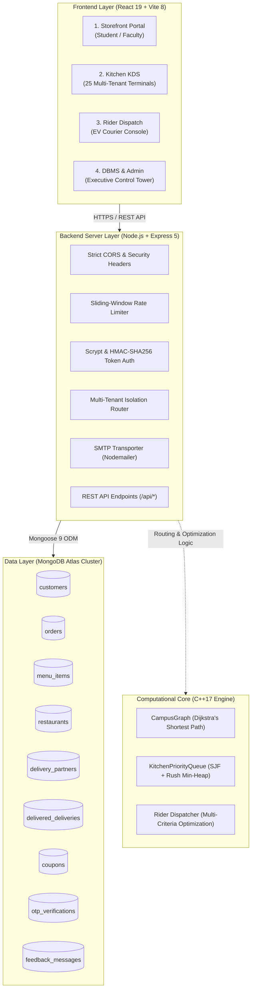

# 🎓 MIT-WPU CampusBites: Smart Campus Dining & Logistics Platform

[](https://nodejs.org/)
[](https://react.dev/)
[](https://expressjs.com/)
[](https://www.mongodb.com/atlas)
[](https://isocpp.org/)

> **Autonomous multi-tenant food court ordering, kitchen priority scheduling, and campus EV courier dispatch platform engineered for MIT World Peace University (MIT-WPU), Pune.**

---

## 📌 Executive Summary

**MIT-WPU CampusBites** is an enterprise-grade academic smart campus dining and delivery management platform. Connecting 20,000+ university students, faculty, 25 partner brand outlets, 6 smart campus EV couriers, and central university operations, it eliminates break-time cafeteria congestion through algorithmic dispatch and real-time database synchronization.

### 🌟 Core Highlights
* **4 Operational Portals**: Student Food Court Storefront, Multi-Tenant Kitchen Display System (KDS), Courier Dispatch Console, and Master DBMS & Admin Control Tower.
* **C++ Algorithmic Core**: High-performance C++17 engine implementing **Dijkstra's Algorithm** for inter-building EV routing and **Binary Heap (Min-Heap) Priority Queues** for rush-hour meal scheduling.
* **Multi-Tenant Server Isolation**: Strict authorization partitions 25 food court brand stalls (Domino's, McDonald's, KFC, Subway, Starbucks, etc.) with zero cross-tenant order leakage.
* **Zero-Leak Cryptography**: Scrypt password key derivation, constant-time verification, and SHA-256 hashed 6-digit OTPs delivered via SMTP.
* **Tri-Lingual Localization**: Seamless dynamic interface translation across **English**, **Hindi (हिंदी)**, and **Marathi (मराठी)**.

---

## 🏛️ System Architecture



---

## 🛠️ Technology Stack

| Layer | Technologies & Tools |
| :--- | :--- |
| **Frontend** | React 19, Vite 8, Tailwind CSS, Responsive Grid, Custom Pure-SVG Vector Engine, HTML5 Canvas Confetti |
| **Backend API** | Node.js, Express 5, Mongoose 9, Nodemailer, Native Node.js `crypto` |
| **Database** | MongoDB Atlas Cloud Replica Set (`campusbites` DB), BSON Document Model |
| **Algorithms** | C++17, Min-Heap Priority Queues, Adjacency List Graphs, Dijkstra's Algorithm |
| **Security** | Scrypt (`scryptSync`), Timing-Safe Equality (`timingSafeEqual`), HMAC-SHA256 Tokens, Sliding-Window Rate Limiting |

---

## 🚀 The 4 Operational Roles & Portals

### 1. Student & Faculty Storefront (`CUSTOMER`)
* Browse 25 brand outlets and 14 dietary categories.
* Instant dish search with "Pure Veg Only" filter switch.
* Strict Authentication Gate: Unauthenticated browsing is permitted, while cart additions and checkout force verified sign-in.
* Interactive tray drawer with 5% campus GST, ₹20 delivery fee logic, and active vouchers (`CAMPUS50`, `DOMINOS30`, `BIRYANI100`, etc.).
* Dynamic food image engine with multi-tier caching (Memory Map + LocalStorage + Wikipedia Commons fallback).
* Live order tracking timeline with pickup codes, assigned rider cards, and safe kitchen-prep cancellation.

### 2. Multi-Tenant Kitchen Display System (`RESTAURANT`)
* Strict server-side isolation: 25 distinct authorized email logins and unique passwords.
* Master Kitchen Supervisor (`kds@mitwpu.edu.in`) with unified cross-stall visibility.
* 3-tab terminal: Active Prep Queue, Completed & Delivered History, and Live Menu Management (CRUD to create, price-adjust, or disable dishes directly in MongoDB Atlas).

### 3. Smart Courier Dispatch Console (`DRIVER` / `DELIVERY_PARTNER`)
* Fleet management for 6 MIT-WPU EV courier riders across campus academic blocks (Saraswati, Chanakya, Shivaji, Ramanujan, Peace Dome).
* Order claiming pool for unassigned counter-ready meals.
* Delivery handover verification requiring pickup OTP before final completion.

### 4. Master DBMS & Operations Control Tower (`ADMIN`)
* Executive credential access (`admin@mitwpu.edu.in`).
* 6 Executive KPI Metric cards: Total Orders, Placed/In-Prep, Active Delivering, Delivered, Cancelled, and Gross GMV Revenue.
* Real-time courier fleet telemetry table monitoring rider statuses, vehicle registrations, and delivery metrics.
* Master Multi-Restaurant Order Ledger with multi-dimensional filtering.
* Live Raw BSON Document Inspector allowing evaluators to inspect database records directly.

---

## ⚙️ Quick Installation & Setup Guide

### Prerequisites
* **Node.js**: v18.0.0 or higher
* **npm**: v9.0.0 or higher
* **C++ Compiler**: GCC (g++), Clang, or MSVC supporting C++17
* **MongoDB Atlas Account** (or local MongoDB v6.0+)

### 1. Clone the Repository
```bash
git clone https://github.com/talk2abhishek10/campusbites-mitwpu-dbms.git
cd campusbites-mitwpu-dbms
```

### 2. Environment Configuration
Copy `.env.example` to `.env` in the root directory:
```bash
cp .env.example .env
```
Fill in your database connection string and SMTP details in `.env`:
```env
PORT=5000
MONGO_URI=mongodb+srv://<username>:<password>@cluster0.rd5t7ox.mongodb.net/campusbites?retryWrites=true&w=majority
SMTP_EMAIL=your-email@mitwpu.edu.in
SMTP_APP_PASSWORD=your-16-char-app-password
```

### 3. Install Dependencies & Seed Database
```bash
# Install backend dependencies
npm install

# Optional: Seed initial database catalog (25 outlets, 100 dishes, 6 couriers)
node seed.js
```

### 4. Run Backend API Server
```bash
node server.js
# API will start on http://localhost:5000
```

### 5. Install & Launch Frontend Client
In a new terminal window:
```bash
cd client
npm install
npm run dev
# Frontend will be live on http://localhost:5173
```

### 6. (Optional) Run C++ Algorithmic Engine & Test Suite
```bash
cd cpp-engine
g++ -std=c++17 -O2 main.cpp -o campusbites_engine.exe
.\campusbites_engine.exe --test
```

---

## 👥 Project Engineering Team & Contributors

Engineered at **MIT World Peace University (MIT-WPU), Pune**:

| Name | GitHub | LinkedIn | Email |
| :--- | :--- | :--- | :--- |
| **Abhishek Sahoo** | [@itsabhi1030](https://github.com/itsabhi1030) | [LinkedIn](https://www.linkedin.com/in/abhishek-sahoo-7b7209312) | `abhishek.sahoo@mitwpu.edu.in` |
| **Pratik Kumar Sahu** | [@Matrixfender](https://github.com/Matrixfender) | [LinkedIn](https://www.linkedin.com/in/pratikkumarsahu0157/) | `pratikkumar.sahu@mitwpu.edu.in` |
| **Shreyas Chakraborty** | [@shreyas22-web](https://github.com/shreyas22-web) | [LinkedIn](https://www.linkedin.com/in/shreyas-chakraborty-875a743a5/) | `shreyas.chakraborty@mitwpu.edu.in` |
| **Siddhi Garud** | [@siddhigarud15-debug](https://github.com/siddhigarud15-debug) | [LinkedIn](https://www.linkedin.com/in/siddhi-garud-945a31344/) | `siddhi.garud@mitwpu.edu.in` |

---

## 📄 License
This project is developed for academic evaluation for DBMS CCA 2 at MIT World Peace University.
